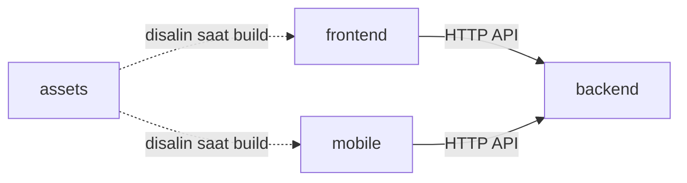

# Struktur proyek berinduk

Satu proyek aplikasi dibagi menjadi empat induk di root-nya: `backend`, `frontend`, `mobile`, dan `assets`. Halaman ini menjelaskan isi setiap induk, aturan hubungan antarinduk, dan cara MCP server Zul membantu merapikan proyek yang sudah ada menjadi struktur ini.

> [!NOTE]
> Halaman ini untuk aplikasi yang kamu bangun dengan Zul. Repository Zul sendiri adalah library, dan memakai tiga kategori yang berbeda: `framework`, `docs`, dan `research`.

## Empat induk

| Induk | Isinya | Bukan isinya |
|---|---|---|
| `backend` | Server, API, aturan bisnis, akses database, dan layanan AI. Di Python, strukturnya mengikuti [arsitektur hexagonal](arsitektur-hexagonal.md), dan `zul build hexa` membuat kerangkanya. | Halaman web, layar mobile, atau gambar. |
| `frontend` | Aplikasi web yang berjalan di browser. | Logika bisnis yang harus dijaga server, dan kode mobile. |
| `mobile` | Aplikasi Android dan iOS, baik Flutter, React Native, maupun native. | Kode web, dan logika bisnis yang harus dijaga server. |
| `assets` | File yang bukan kode: gambar, ikon, font, video, audio, data mentah, berkas desain, dan dokumen. | Script, kode, dan rahasia. |

Setiap induk adalah satu unit yang bisa dibangun, diuji, dan di-deploy sendiri. Karena itu setiap induk punya manifest dependency, `README.md`, dan test sendiri.

Proyek tidak wajib memiliki keempatnya. Proyek tanpa aplikasi mobile tidak memiliki folder `mobile`.

## Contoh pohon

```text
toko/
├── backend/
│   ├── src/              # domain, application, infrastructure, interface
│   ├── test/
│   ├── Dockerfile
│   ├── pyproject.toml
│   ├── .env.example
│   └── README.md
├── frontend/
│   ├── src/
│   ├── package.json
│   ├── .env.example
│   └── README.md
├── mobile/
│   ├── lib/
│   ├── pubspec.yaml
│   └── README.md
├── assets/
│   ├── images/
│   ├── fonts/
│   └── videos/
├── docs/
├── docker-compose.yml
├── .gitignore
└── README.md
```

Yang boleh tinggal di root, di luar keempat induk, hanya file dan folder yang menyangkut seluruh proyek: `README.md`, `LICENSE`, `CONTRIBUTING.md`, `CHANGELOG.md`, `docs/`, `scripts/`, `infra/`, `docker-compose*.yml`, `Makefile`, `justfile`, dan semua file berawalan titik seperti `.gitignore`, `.github/`, dan `.env.example`.

## Arah dependensi



Garis penuh adalah panggilan saat aplikasi berjalan. Garis putus-putus adalah penyalinan file saat build, bukan impor kode.

Aturannya:

1. **Satu induk, satu unit.** Setiap induk punya manifest dependency, `README.md`, dan test di dalam foldernya sendiri. Induk bisa dibangun tanpa induk lain.
2. **`frontend` dan `mobile` hanya memanggil `backend` lewat HTTP API.** Keduanya tidak mengimpor kode `backend`, walaupun bahasanya sama.
3. **`backend` tidak mengenal klien.** Tidak ada import dari `frontend` atau `mobile`.
4. **`frontend` dan `mobile` tidak saling mengimpor.** Logika yang dipakai keduanya dipindahkan ke `backend`.
5. **Kontrak API milik `backend`.** `backend` menerbitkan skema API (OpenAPI di FastAPI). Klien membuat tipe datanya sendiri dari skema itu, di dalam foldernya, tanpa menyalin tipe dengan tangan.
6. **`assets` tidak berisi kode.** File di `assets` adalah satu-satunya sumber. `frontend` dan `mobile` menyalinnya saat build lewat skrip di induknya masing-masing, misalnya `frontend/scripts/sync-assets`, bukan lewat impor relatif lintas induk.
7. **Rahasia tinggal di induknya.** Setiap induk yang butuh rahasia punya `.env` sendiri, yang diabaikan `.gitignore`, dan `.env.example` yang di-commit.
8. **Induk baru adalah keputusan arsitektur.** Jangan menambah induk kelima untuk "kode bersama". Kode bersama biasanya menandakan logika yang seharusnya ada di `backend`, atau tipe yang bisa dibuat dari skema API.

## Cara mengenali induk sebuah folder

`check_layout` memilih induk dari tanda di dalam folder. Folder yang cocok dengan lebih dari satu induk tidak ditebak: ia dilaporkan sebagai perlu keputusan.

| Induk | Tanda |
|---|---|
| `mobile` | `pubspec.yaml`, `AndroidManifest.xml`, `Podfile`, folder `android`, `ios`, atau `*.xcodeproj`, atau `package.json` yang memakai `react-native`, `expo`, `@capacitor/core`, atau `nativescript`. |
| `frontend` | `vite.config.*`, `next.config.*`, `nuxt.config.*`, `astro.config.*`, `svelte.config.*`, `angular.json`, atau `package.json` yang memakai `react-dom`, `next`, `vue`, `nuxt`, `svelte`, `@sveltejs/kit`, `@angular/core`, `astro`, `solid-js`, atau `vite`. |
| `backend` | `pyproject.toml`, `requirements.txt`, `Pipfile`, `manage.py`, `alembic.ini`, `go.mod`, `pom.xml`, `Cargo.toml`, `composer.json`, `Gemfile`, atau `package.json` yang memakai `express`, `fastify`, `@nestjs/core`, `koa`, atau `hono`. |
| `assets` | Folder yang berisi gambar, font, video, audio, data CSV atau Parquet, berkas desain, atau dokumen tanpa file kode, dan file lepas dengan ekstensi itu. |

Folder tanpa tanda diputuskan dari isinya: jika sedikitnya 60 persen file kodenya satu jenis, misalnya `.py` untuk `backend` atau `.tsx` untuk `frontend`, folder itu mengikuti jenis tersebut.

`react` saja tidak menandai `frontend`, karena React Native juga memakainya. Yang dipakai adalah `react-dom`.

## Merapikan proyek yang sudah ada dengan MCP

MCP server Zul punya dua tool dan satu prompt untuk pekerjaan ini. Semuanya hanya membaca, jadi yang memindahkan file adalah code assistant-mu, dan hanya setelah kamu setuju.

| Nama | Jenis | Gunanya |
|---|---|---|
| `layout_rules` | tool dan resource `zul://layout` | Mengembalikan halaman ini, supaya assistant mengikuti aturan yang sama dengan yang kamu baca. |
| `check_layout` | tool | Memeriksa folder proyek dan mengembalikan rencana: file yang perlu dipindahkan beserta perintah `git mv`, folder yang perlu keputusan, impor yang melompati batas induk, dan kekurangan tiap induk. |
| `rapikan_arsitektur` | prompt | Urutan kerja lengkap untuk assistant: baca aturan, periksa, minta persetujuan, pindahkan, perbaiki path, uji, periksa ulang. |

Langkahnya:

1. Hubungkan code assistant ke MCP Zul. Caranya ada di [Menghubungkan code assistant](../panduan/menghubungkan-code-assistant.md).
2. Buka proyek yang akan dirapikan, lalu jalankan prompt `/mcp__zul__rapikan_arsitektur` di Claude Code, atau minta assistant memakai tool `check_layout`.
3. Baca rencananya. Untuk setiap folder di bagian "Perlu keputusan", sebutkan induk tujuannya.
4. Setujui rencana. Assistant menjalankan `git mv` satu per satu, sehingga riwayat file tetap terjaga.
5. Assistant memperbarui path di Dockerfile, `docker-compose`, konfigurasi CI, dan README, lalu menjalankan test di setiap induk.
6. Assistant memanggil `check_layout` lagi sampai hasilnya "Struktur sudah sesuai".

Sebuah folder yang berisi satu aplikasi utuh diganti namanya menjadi induknya. Misalnya, `web/` yang berisi `package.json` dengan `react-dom` menjadi `frontend/` lewat `git mv -- web frontend`. Jika ada dua aplikasi sejenis, misalnya `api/` dan `worker/`, keduanya dipindahkan ke dalam induknya: `backend/api` dan `backend/worker`.

### Yang dibaca dan tidak dibaca

`check_layout` membaca nama file dan folder, nama dependency di `package.json`, dan baris impor di file kode. Isi `.env` tidak pernah dibaca; hanya keberadaannya yang diperiksa. Symlink tidak diikuti, dan pemeriksaan berhenti di 4.000 file kode.

### Batas keamanan

- **Folder yang boleh diperiksa.** Hanya folder di dalam folder kerja server, yaitu folder tempat code assistant dibuka, dan folder yang terdaftar di environment variable `ZUL_PROJECT_ROOTS`. Pisahkan beberapa folder dengan `;` di Windows atau `:` di Linux dan macOS. Root drive dan folder home ditolak, karena terlalu luas untuk satu proyek.
- **Nama file adalah data, bukan perintah.** Nama file berasal dari folder yang diperiksa, yang bisa saja berasal dari repository orang lain. Nama yang berisi karakter selain huruf, angka, spasi, titik, minus, garis bawah, dan garis miring tidak dibuatkan perintah `git mv`; namanya ditampilkan dalam bentuk ber-escape (misalnya `\x24` untuk `$`) dan folder itu masuk "Perlu keputusan". Semua perintah memakai `git mv --`, supaya nama berawalan `-` tidak dibaca sebagai opsi.

### Yang belum diperiksa

- Impor lintas induk yang disamarkan oleh alias path atau workspace (misalnya `@app/backend`). Yang diperiksa hanya impor berpath relatif dan, di Python, `import backend`, `import frontend`, atau `import mobile`.
- Referensi dari kode ke file di `assets`. Aturan 6 di atas ditegakkan lewat review, bukan lewat tool.
- Apakah kontrak API klien benar-benar dibuat dari skema `backend`.

## Keputusan yang tetap di tanganmu

- **Folder campuran.** Folder yang berisi kode web dan server sekaligus harus dipecah oleh pemiliknya. Tool tidak menebak.
- **Tipe bersama.** Jika `frontend` dan `mobile` perlu tipe data yang sama, buat tipe itu dari skema API `backend` di setiap klien.
- **Nama `assets`.** Folder bernama jamak, seperti `docs/assets` di repository Zul. Nama ini tetap, dan `check_layout` tidak menerima `asset`.
- **Monorepo atau repo terpisah.** Struktur ini cocok untuk satu repository. Jika setiap induk berada di repository sendiri, aturan 1 sampai 8 tetap berlaku, tetapi `check_layout` tidak bisa memeriksa impor lintas repository.

## Halaman terkait

- [Arsitektur hexagonal](arsitektur-hexagonal.md) untuk susunan di dalam `backend`.
- [Membuat proyek](../panduan/membuat-proyek.md) untuk `zul build hexa`.
- [MCP server](../referensi/mcp.md) untuk daftar tool, resource, dan prompt.
- [Menghubungkan code assistant](../panduan/menghubungkan-code-assistant.md) untuk memasang MCP Zul.
