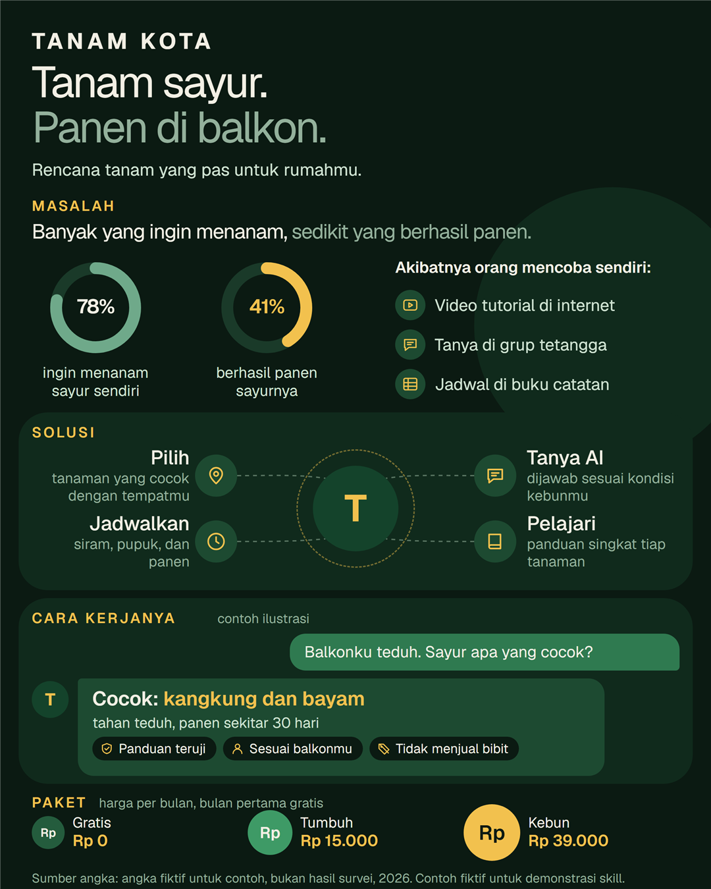
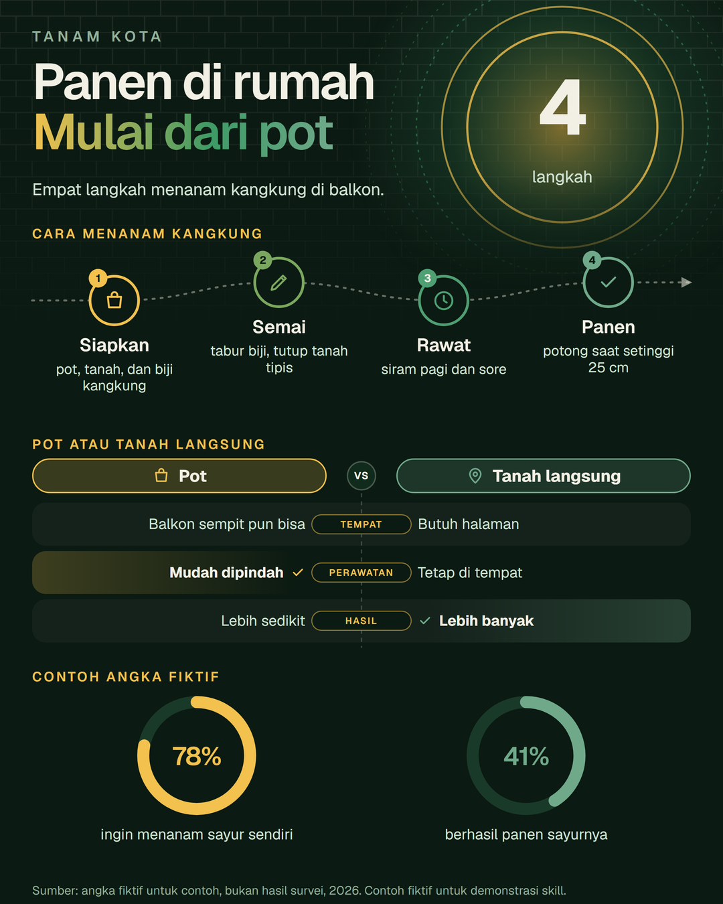
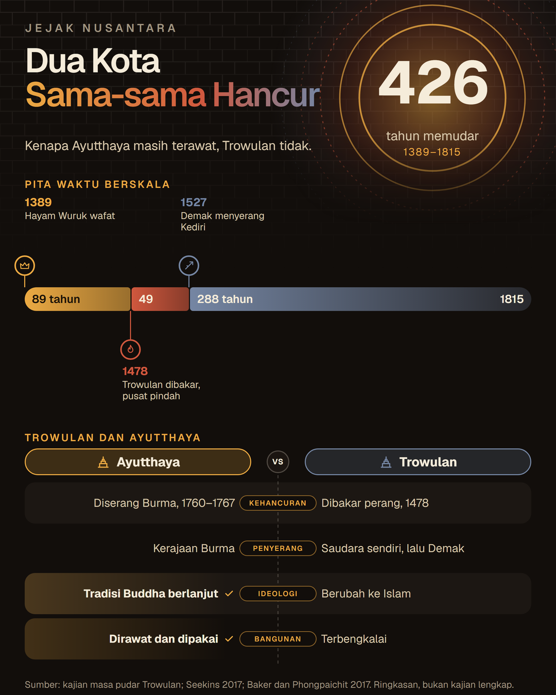
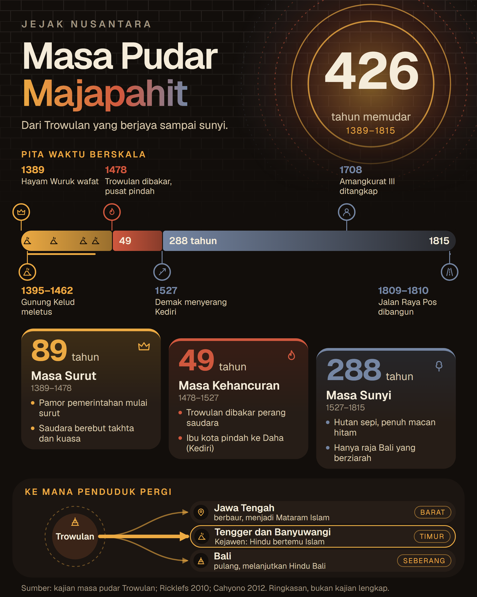

# Membuat infografis satu lembar

Skill `infografis_satu_lembar` membuat infografis 4:5 (1080×1350, siap diunggah ke Instagram) dalam tiga susunan: **produk**, yang menjelaskan sebuah produk atau jasa lewat masalah, solusi, contoh cara kerja, dan harga, **adaptif**, yang menyusun lembar dari blok visual yang dipilih menurut bentuk informasinya, dan **linimasa**, rakitan siap pakai untuk satu periode sejarah yang terbagi tiga masa. Model hanya mengisi satu berkas JSON berisi teks pendek. Skrip yang memeriksa dan menggambarnya, jadi model kecil pun bisa memakainya.



Gambar di atas dibuat dari `contoh/tanam_kota.json` di folder skill. Produknya, angkanya, dan sumbernya fiktif, dan gambarnya sendiri menyebut itu di bagian bawah.

**Sebelum mulai:** kamu butuh [Node.js](https://nodejs.org) 18 atau lebih baru (periksa dengan `node --version`) dan kamu berada di root repository Zul. Skill ada di `framework/agentic/skills/infografis_satu_lembar/`. Tidak ada paket yang perlu di-install. PNG dan PDF butuh Edge, Chrome, atau Chromium. Tanpa itu, kamu tetap mendapat `infografis.html` yang bisa dibuka di peramban.

## Cara kerja

Pembagian tugasnya yang membuat hasilnya terjaga:

| Tahap | Dikerjakan oleh | Cara menjaga hasilnya |
|---|---|---|
| Mengisi `isi.json` | Model | Bentuk tetap (`contoh/kosong.json`), jumlah butir tetap, dan nama ikon dipilih dari daftar |
| `cek.mjs` | Skrip | Batas huruf tiap isian. Menolak kata kabur, emoji, kalimat ambigu, angka tanpa sumber, dan arti angka yang terlalu singkat. Pesannya pendek dan menyebut perbaikannya |
| `bangun.mjs` | Skrip | Tata letak tetap. Setelah digambar, memeriksa apakah ada teks yang bertumpuk atau keluar lembar |

Ada tiga susunan:

| Susunan | Untuk | Bagian | Cetakan |
|---|---|---|---|
| `produk` (bawaan) | Produk atau jasa | Kepala, masalah (dua cincin angka dan tiga hal yang dilakukan orang), solusi (empat simpul), contoh tanya jawab, dan paket harga (2 sampai 4). Bagiannya tetap | `contoh/kosong.json` |
| `adaptif` | Informasi dengan bentuk apa pun: urutan tahun, tahapan, aliran, perbandingan, langkah, angka persen | Kepala dan 2 sampai 4 blok yang kamu pilih. Tinggi tiap blok menyesuaikan isinya | `contoh/kosong_adaptif.json` |
| `linimasa` | Satu periode sejarah yang terbagi tiga masa | Judul dengan angka besar, pita waktu berskala, peristiwa penting, tiga kartu masa, dan diagram dari satu pusat ke tiga tujuan. Di dalamnya memakai blok adaptif | `contoh/kosong_linimasa.json` |

Susunan dipilih lewat isian `"susunan"` di `isi.json`. Tanpa isian itu, yang dipakai adalah `produk`. Bagian di bawah memakai susunan produk; susunan adaptif dijelaskan di [Susunan adaptif](#susunan-adaptif) dan linimasa di [Susunan linimasa](#susunan-linimasa).

## Membuat infografis dari terminal

1. Salin cetakan ke folder kerjamu sebagai `isi.json`:

    ```shell
    cp framework/agentic/skills/infografis_satu_lembar/contoh/kosong.json isi.json
    ```

    Di Windows PowerShell, pakai `Copy-Item` sebagai ganti `cp`.

2. Ganti setiap teks di antara `[ ... ]` dengan isi sebenarnya. Angka dan nama harus datang dari faktamu, dan dua angka di bagian masalah harus punya sumber (lembaga dan tahun). Bentuk yang sudah benar ada di `contoh/tanam_kota.json`.

3. Periksa isinya:

    ```shell
    node framework/agentic/skills/infografis_satu_lembar/scripts/cek.mjs isi.json
    ```

    Perintah itu mencetak `LOLOS` atau `BELUM LOLOS`. Untuk setiap baris `GAGAL`, perbaiki persis seperti pesannya, lalu jalankan lagi. Contoh keluaran untuk `contoh/tanam_kota.json`:

    ```text
    LOLOS: 0 gagal, 0 peringatan, 119 kata.
    ```

4. Gambar:

    ```shell
    node framework/agentic/skills/infografis_satu_lembar/scripts/bangun.mjs isi.json
    ```

    Hasilnya ada di folder `hasil/`: `infografis.png` (2160×2700), `infografis.pdf`, dan `infografis.html`. Jika ada baris `BERTUMPUK`, perpendek teks yang disebut lalu jalankan lagi. Tanpa Chrome atau Edge, tambahkan `--tanpa-gambar` untuk hanya membuat `infografis.html`.

5. Buka `hasil/infografis.png` dan periksa tiga hal: setiap angka punya arti yang bisa dipahami orang awam, tidak ada kata yang membuat pembaca bertanya "maksudnya apa?", dan tidak ada teks yang terpotong.

> [!NOTE]
> Huruf Geist dimuat dari Google Fonts saat menggambar, jadi butuh internet. Tanpa itu, huruf pengganti dipakai, dan pemeriksa tumpang tindih memberi tahu bila teks tidak muat.

## Susunan adaptif

Susunan produk dan linimasa memaksa isinya masuk ke satu cetakan. Susunan adaptif membalik urutannya: kamu melihat dulu bentuk informasinya, lalu memilih blok yang cocok, dan skrip menyusun lembarnya dari blok itu. Dua contoh di bawah dibuat dari bentuk isi yang berbeda, bukan dari satu cetakan yang sama:





Gambar pertama dari `contoh/adaptif_cara_menanam.json` (langkah, perbandingan, dan angka; semua isinya fiktif) dan gambar kedua dari `contoh/adaptif_dua_kota.json` (pita waktu dan perbandingan).

### Memilih blok

Pilih blok menurut bentuk informasinya:

| Bentuk informasi | Blok | Yang digambar |
|---|---|---|
| Berjalan dari tahun ke tahun, dengan masa dan peristiwa | `pita_waktu` | Pita berskala dengan lebar sebanding lama masa, dan peristiwa di atas dan di bawahnya |
| Tahapan berurutan yang masing-masing punya ciri | `tahap` | Kartu yang turun seperti anak tangga (2 sampai 3 tahap) atau baris yang menjorok (4 sampai 5 tahap) |
| Satu pusat mengalir ke beberapa tujuan | `alur` | Lingkaran pusat dengan panah ke 2 sampai 4 tujuan, panah tebal untuk yang paling banyak dituju |
| Dua pihak dibandingkan pada beberapa hal | `banding` | Dua kepala berhadapan, 3 sampai 5 baris sepanjang satu garis tengah, dan tanda centang pada pihak yang unggul |
| Cara melakukan sesuatu, urut dari awal | `langkah` | 3 sampai 5 langkah bernomor di sepanjang jalur berkelok yang berujung panah |
| Dua sampai empat angka persen | `angka` | Cincin yang terisi sesuai angkanya, dengan arti di bawahnya |

Aturannya:

- Pakai 2 sampai 4 blok, dan satu jenis paling banyak sekali. Urutan di `blok` adalah urutan dari atas ke bawah.
- Blok pertama menentukan angka sorotan di kepala bila `kepala.sorot` tidak diisi: jumlah tahun untuk pita waktu, dan jumlah langkah, tahap, tujuan, atau pembanding untuk blok lain. Angka itu dihitung skrip.
- Warna mengikuti jumlah butir: pita dengan lima masa memakai lima warna dari palet merek, dan tiga tahap memakai tiga.
- Tinggi blok menyesuaikan jumlah butirnya, lalu sisa ruang lembar dibagi ke blok yang masih bisa melebar. Sebelum menggambar, `cek.mjs` menghitung apakah semua blok muat. Jika tidak, ia melapor `terlalu padat` beserta tinggi tiap blok.
- Bagian informasi yang tidak cocok dengan satu pun bentuk jangan dipaksakan ke blok yang salah. Buang atau persingkat bagian itu.

Bentuk lengkap tiap blok, batas hurufnya, dan contoh yang sudah lolos pemeriksaan ada di `references/katalog_blok.md` di folder skill.

### Membuat infografis adaptif

1. Salin cetakannya. Cetakan hanya berisi dua blok sebagai contoh bentuk:

    ```shell
    cp framework/agentic/skills/infografis_satu_lembar/contoh/kosong_adaptif.json isi.json
    ```

2. Ganti, tambah, atau buang blok sesuai bentuk informasimu, dengan potongan dari `references/katalog_blok.md`. Ganti setiap teks di antara `[ ... ]`. Semua tahun dan semua `nilai` ditulis sebagai angka tanpa tanda kutip.

3. Periksa dan gambar dengan dua perintah yang sama dengan susunan lain:

    ```shell
    node framework/agentic/skills/infografis_satu_lembar/scripts/cek.mjs isi.json
    node framework/agentic/skills/infografis_satu_lembar/scripts/bangun.mjs isi.json
    ```

    Contoh keluaran `cek.mjs` untuk `contoh/adaptif_cara_menanam.json`:

    ```text
    LOLOS: 0 gagal, 0 peringatan, 88 kata.
    ```

Pesan `GAGAL` khusus susunan adaptif ada di [Memperbaiki pesan GAGAL](#memperbaiki-pesan-gagal).

### Hubungan dengan susunan linimasa

Susunan `linimasa` sekarang adalah rakitan siap pakai dari blok adaptif: pita waktu, tahap yang mengikuti pita, dan alur. Isian lamanya tetap berlaku, jadi berkas `isi.json` linimasa yang sudah ada menghasilkan gambar yang sama. Pakai `adaptif` bila isinya tidak persis berbentuk tiga masa dan satu sebaran.

## Susunan linimasa

Susunan ini dibuat untuk isi yang berjalan dari tahun ke tahun, dan visualnya mengikuti isinya, bukan tabel. Contohnya dari uraian tentang Masa Pudar Majapahit, dengan sumber yang disebut di uraian itu:



Apa yang digambar dari datanya:

| Bagian | Dari mana | Visualnya |
|---|---|---|
| Angka besar (426) | Dihitung: tahun selesai terakhir dikurangi tahun mulai pertama | Menjadi pusat cincin matahari yang makin redup ke luar |
| Pita waktu | Tiga masa dan tahunnya | Lebar tiap potongan sebanding dengan lama masanya (89, 49, dan 288 tahun), dan warnanya memudar dari emas, bara, ke abu |
| Peristiwa | Tahun, teks, dan ikon | Penanda berselang-seling di atas dan di bawah pita. `sampai` menggambar kurung rentang, dan `titik` menggambar ikon di dalam pita |
| Kartu masa | Nama, lama (dihitung), dan dua poin | Turun seperti anak tangga, mengikuti arah memudar |
| Diagram sebaran | Satu pusat dan tiga tujuan | Panah dari pusat ke tiga tujuan, dengan panah tebal untuk tujuan yang paling banyak (`utama`) |
| Latar | Tetap | Pola bata yang menghilang ke bawah |

Lama tiap masa dan jumlah tahun seluruhnya tidak ditulis oleh model. Skrip menghitungnya dari tahun, sehingga tidak ada angka yang bisa salah ketik.

Cara membuatnya sama dengan susunan produk. Bedanya hanya cetakan dan pertanyaan yang diajukan ke pengguna:

1. Salin cetakannya:

    ```shell
    cp framework/agentic/skills/infografis_satu_lembar/contoh/kosong_linimasa.json isi.json
    ```

2. Isi dengan fakta dari uraianmu. Yang dibutuhkan: judul dua baris dan satu kalimat tentang periodenya, tiga masa berurutan (nama, tahun mulai, tahun selesai, dan dua ciri pendek), tiga sampai tujuh peristiwa, tiga tujuan dari satu pusat, dan sumber. Tahun selesai satu masa harus sama dengan tahun mulai masa berikutnya, dan semua tahun ditulis sebagai angka tanpa tanda kutip.

3. Periksa dan gambar dengan dua perintah yang sama:

    ```shell
    node framework/agentic/skills/infografis_satu_lembar/scripts/cek.mjs isi.json
    node framework/agentic/skills/infografis_satu_lembar/scripts/bangun.mjs isi.json
    ```

Bentuk yang sudah benar ada di `contoh/majapahit_masa_pudar.json`. Pesan `GAGAL` khusus linimasa ada di [Memperbaiki pesan GAGAL](#memperbaiki-pesan-gagal). Untuk model tanpa fitur skill, `references/prompt_satu_tempelan.md` punya bagian A sendiri untuk linimasa.

> [!NOTE]
> Peristiwa yang tahunnya berdekatan bisa membuat labelnya bertumpuk. Jika `bangun.mjs` melaporkan `BERTUMPUK` pada peristiwa, perpendek teksnya, atau gabungkan peristiwa yang berdekatan menjadi satu butir dengan `sampai` dan `titik`.

## Membuat infografis lewat agent

Skill memakai format yang sama dengan skill lain di [skill pool](https://github.com/kazuma313/zul_utilities/tree/main/framework/agentic): `SKILL.md` berisi langkah untuk agent, dan `METADATA.md` berisi kebutuhan dan batasnya. Agent yang membaca `SKILL.md` akan:

1. Menanyakan faktamu dalam satu pesan berisi daftar bernomor. Untuk produk: nama produk dan tujuannya, masalah dengan dua angka beserta sumbernya, tiga hal yang dilakukan orang sekarang, empat fitur, satu contoh tanya jawab, harga paket, dan batasan produk. Untuk informasi lain, agent memilih blok dari bentuk isinya dan menanyakan bahan tiap blok: misalnya tahun mulai dan selesai tiap masa, atau langkah berurutan, atau dua pihak yang dibandingkan.
2. Berhenti dan menyebut apa yang kurang jika ada yang belum kamu jawab. Agent tidak boleh mengisinya dengan karangan.
3. Mengisi `isi.json`, memeriksa, memperbaiki, menggambar, lalu menyebut lokasi hasilnya dan angka yang perlu kamu periksa.

Dari Python, dua fungsi pembungkusnya mengembalikan teks pendek dan tidak pernah melempar exception:

```python
import sys

sys.path.insert(0, "framework/agentic")

from skills.infografis_satu_lembar.infografis_satu_lembar_skill import (
    buat_infografis,
    periksa_infografis,
)

print(periksa_infografis(isi_json))
print(buat_infografis(isi_json, "produkku"))
```

`isi_json` boleh berupa teks JSON, JSON yang dibungkus tanda ``` atau diberi kalimat pembuka (model kecil sering begitu), atau dict. Berkas hasil ditulis di `hasil/produkku/`. Folder dasarnya bisa diganti lewat environment variable `INFOGRAFIS_OUTPUT_DIR`, dan nama subfoldernya tidak bisa keluar dari folder itu. Jika `langchain-core` ter-install, `periksa_infografis_tool` dan `buat_infografis_tool` tersedia sebagai tool LangChain.

## Memakai model tanpa fitur skill

Untuk AI yang tidak mengenal folder skill, termasuk model kecil, pakai `references/prompt_satu_tempelan.md` di folder skill. Tempel bagian A, lalu isi `contoh/kosong.json`, lalu fakta produkmu. Berkas itu juga punya bagian A sendiri untuk susunan adaptif dan linimasa. Model cukup menjawab dengan JSON. Simpan jawabannya sebagai `isi.json`, jalankan `cek.mjs`, dan jika ada `GAGAL`, tempel pesannya ke model dengan permintaan "Perbaiki JSON ini sesuai pesan, jawab hanya JSON."

## Memperbaiki pesan GAGAL

| Pesan | Perbaikan |
|---|---|
| `terlalu panjang (N huruf, maksimal M)` | Perpendek isian itu. Pesannya menyebut teks sekarang. |
| `kata "terbaik" tidak jelas` | Ganti dengan fakta: angka, nama, atau contoh. Kata terlarang lain: terlengkap, canggih, inovatif, dll, dan sebagainya. |
| `nama ikon "..." tidak ada` | Pilih dari daftar ikon. Pesannya mencetak seluruh daftarnya. |
| `harus berisi tepat 4 simpul` | Jumlah butir di tiap daftar harus persis seperti contoh. |
| `harus angka 0 sampai 100` | Tulis `nilai` tanpa tanda kutip dan tanpa `%`, misalnya `78`. |
| `angkanya harus sama dengan nilai` | `tampil` ("78%") harus sama dengan `nilai` (78). |
| `terlalu singkat` | Arti angka butuh minimal 3 kata, misalnya "tahu dan terampil merawatnya", bukan "paham". |
| `kalimat ini ambigu` | "Tanpa jual produk" membuat pembaca mengira kamu tidak menjual apa pun. Tulis "Tidak menjual bibit". |
| `tanda * hanya boleh dipakai` | Tanda `*` hanya untuk menyorot angka di `contoh.jawab_utama`, tepat sepasang. |
| `nama merek tidak ditemukan` | Isi `"merek"` dengan nama berkas di `merek/`, tanpa `.json`. |

Pesan khusus susunan linimasa:

| Pesan | Perbaikan |
|---|---|
| `harus 1478, sama dengan akhir masa sebelumnya` | Tahun mulai sebuah masa harus sama dengan tahun selesai masa sebelumnya, supaya pita waktu tidak berlubang. |
| `harus lebih besar dari mulai` | Tahun selesai sebuah masa harus lebih besar dari tahun mulainya. |
| `harus tahun berupa bilangan bulat` | Tulis tahun sebagai angka tanpa tanda kutip, misalnya `1389`. |
| `harus berisi tepat 3 masa berurutan` | Susunan ini selalu tiga masa. |
| `di dalam pita waktu (1389 sampai 1815)` | Tahun peristiwa harus berada di antara tahun mulai masa pertama dan tahun selesai masa terakhir. |
| `masing-masing di antara tahun dan sampai` | Setiap tahun di `titik` harus berada di dalam rentang peristiwanya. |
| `harus 0, 1, atau 2` | `utama` adalah nomor tujuan yang paling banyak dituju, dimulai dari 0. Hapus isian ini jika tidak ada yang dominan. |
| `harus salah satu dari: produk, linimasa, adaptif` | Nama susunan salah. Hapus isian `susunan` untuk memakai susunan produk. |

Pesan khusus susunan adaptif:

| Pesan | Perbaikan |
|---|---|
| `harus berisi 2 sampai 4 blok` | Pilih 2 sampai 4 blok menurut bentuk informasinya. |
| `harus salah satu dari: pita_waktu, tahap, alur, banding, langkah, angka` | Nama `jenis` blok salah. Pilih salah satu dari enam itu. |
| `blok langkah sudah dipakai` | Satu jenis blok paling banyak sekali. Pilih jenis lain atau gabungkan isinya. |
| `terlalu padat: isinya butuh N piksel dari 970 yang tersedia` | Kurangi satu blok, atau kurangi butirnya. Pesannya menyebut tinggi tiap blok. |
| `label peristiwa ... tidak punya tempat` | Dua peristiwa terlalu dekat di pita waktu. Gabungkan menjadi satu butir dengan `sampai` dan `titik`, atau hapus salah satu. |
| `harus ... sama dengan jumlah masa di pita_waktu` | Blok `tahap` dengan `ikuti_pita` harus punya tahap sebanyak masa di pita waktu. |
| `jangan diisi: dengan "ikuti_pita"` | `angka`, `satuan`, dan `rentang` dihitung dari pita waktu. Hapus isiannya. |
| `butuh blok pita_waktu yang sah` | `ikuti_pita` atau `"lama_pita"` butuh blok pita waktu. Tambahkan blok itu, atau tulis angkanya sendiri. |
| `harus "kiri" atau "kanan"` | `unggul` di blok banding hanya boleh `"kiri"` atau `"kanan"`. Hapus bila tidak ada yang unggul. |

## Memakai merek sendiri

Warna, huruf, dan logo disimpan per merek di `merek/`. Merek bawaan adalah `tanam_kota`, yang fiktif.

1. Salin `merek/tanam_kota.json` menjadi `merek/<nama>.json`.
2. Ganti `nama`, `font`, `font_url`, dan nilai di `warna`. Ubah `simbol_koin` jika mata uangmu bukan rupiah.
3. Letakkan logo (PNG) di `merek/<nama>/`, lalu isi `logo_kata` dan `logo_lambang` dengan nama berkas, lebar, dan tingginya. Logo boleh dikosongkan (`null`): nama merek ditulis sebagai teks, dan lingkaran logo diisi huruf pertamanya.
4. Isi `"merek": "<nama>"` di `isi.json`.

> [!WARNING]
> Repository Zul bersifat publik. Jangan meng-commit logo atau data merek yang tidak boleh dipublikasikan. Nama merek hanya boleh huruf, angka, `_`, dan `-`.

## Batas skill

- Satu lembar 4:5 dengan tiga susunan: `produk`, `adaptif`, dan `linimasa`. Rasio lain dan lebih dari satu lembar butuh kode baru. Susunan produk digambar di `scripts/bangun.mjs`, dan susunan adaptif dan linimasa di `scripts/adaptif.mjs` dengan satu berkas `scripts/blok_*.mjs` per jenis blok.
- Susunan adaptif punya enam jenis blok. Bentuk informasi di luar itu, misalnya daftar tips atau peta, belum punya blok. Menambah satu jenis berarti satu berkas `blok_*.mjs` baru yang mengekspor `periksa`, `tinggi`, dan `gambar`, dan didaftarkan di `scripts/adaptif.mjs`.
- Bagian rencana (roadmap) dan tangkapan layar aplikasi sengaja tidak ada.
- **Belum diuji dengan model sungguhan.** Skrip dan pemeriksanya sudah diuji (`uv run pytest framework/agentic/skills/infografis_satu_lembar`), tetapi klaim bahwa model kecil bisa mengisi JSON-nya dalam satu sampai tiga putaran perbaikan belum dibuktikan. Sebelum mengandalkannya, jalankan sekali dengan model yang akan kamu pakai.
- Instruksi ditulis dalam bahasa Indonesia. Jika modelmu lemah berbahasa Indonesia, terjemahkan prompt satu tempelan ke bahasa yang dikuasainya. Isi JSON tetap berbahasa Indonesia.

## Langkah berikutnya

- [Membuat mind map](membuat-mindmap.md) dan [Membuat silabus dan materi belajar](membuat-silabus-dan-materi.md) untuk skill lain yang memakai model kecil dengan cara yang sama: model menulis isi, kode menggambar.
- [Model lokal untuk skill belajar](../konsep/model-lokal-untuk-skill-belajar.md) untuk cara memilih model Ollama yang cukup kecil untuk laptop.
